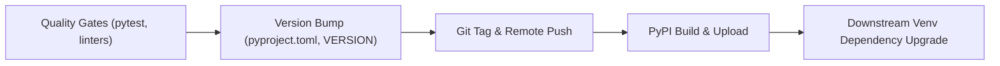

# Python Package Distribution Lifecycle (`goal -a`)

This document describes the automated package release, tagging, publishing, and dependency propagation pipeline using `goal -a`.

---

## 1. Overview of `goal -a`

`goal` is the automated workflow orchestrator in the Wellmanifest ecosystem. The `-a` (`--all`) flag runs an end-to-end governed pipeline:



---

## 2. Execution Modes

### Standard Release Workflow
When working on a ticket branch with uncommitted changes:
```bash
goal -a
```
* Runs tests to enforce the primacy of green tests (*Prymat Zielonych Testów*).
* Bumps version based on commit semantics or project policy.
* Commits, tags, and pushes to remote.
* Publishes artifacts (wheel and sdist) to PyPI.

### Force Publish Workflow
When changes have already been committed through git porcelain or autonomous agents:
```bash
goal -a --force-publish
```
Goal publishes the latest package even if no newly staged changes are present.

### Dependency Upgrade Propagation
To automatically upgrade consumer virtual environments to the new release:
```bash
goal -a -u
# or with recursive subproject updates:
goal -a -u -r
```

---

## 3. PyPI Authentication Configuration

`goal` uses the following resolution order for registry credentials:

1. **Environment Variable:** `PYPI_TOKEN`
   ```bash
   export PYPI_TOKEN="pypi-AgEI..."
   ```
2. **User Configuration:** `~/.pypirc`
   ```ini
   [distutils]
   index-servers = pypi

   [pypi]
   username = __token__
   password = pypi-AgEI...
   ```
3. **Vault Integration:** `@subactor/credential-vault` lease client when running under autonomous supervisor agents.
