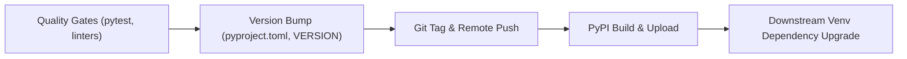

# Python Package Distribution Lifecycle (`goal -a`)

This document describes the automated package release, tagging, publishing, and dependency propagation pipeline using `goal -a`.

---

## 1. Overview of `goal -a`

`goal` is the automated workflow orchestrator in the Wellmanifest ecosystem. The `-a` (`--all`) flag runs an end-to-end governed pipeline:



---

## 2. Execution Modes

### Standard Release Workflow
When working on a ticket branch with uncommitted changes:
```bash
goal -a
```
* Runs tests to enforce the primacy of green tests (*Prymat Zielonych Testów*).
* Bumps version based on commit semantics or project policy.
* Commits, tags, and pushes to remote.
* Publishes artifacts (wheel and sdist) to PyPI.

### Force Publish Workflow
When changes have already been committed through git porcelain or autonomous agents:
```bash
goal -a --force-publish
```
Goal publishes the latest package even if no newly staged changes are present.

### Dependency Upgrade Propagation
To automatically upgrade consumer virtual environments to the new release:
```bash
goal -a -u
# or with recursive subproject updates:
goal -a -u -r
```

---

## 3. PyPI Authentication Configuration

`goal` uses the following resolution order for registry credentials:

1. **Environment Variable:** `PYPI_TOKEN`
   ```bash
   export PYPI_TOKEN="pypi-AgEI..."
   ```
2. **User Configuration:** `~/.pypirc`
   ```ini
   [distutils]
   index-servers = pypi

   [pypi]
   username = __token__
   password = pypi-AgEI...
   ```
3. **Vault Integration:** `@subactor/credential-vault` lease client when running under autonomous supervisor agents.

---

## 4. Distribution Integrity and Parity Rules

To eliminate silent drift between developer source trees, installed environments, and distribution packages:

### PYTHON-DIST-001: Commit-Artifact Parity
* **Invariant:** Every artifact in `dist/` (wheel and sdist) must originate from and correspond byte-for-byte to the exact commit SHA or clean checkout it represents.
* **Prohibition:** Merely matching the SemVer version string in `pyproject.toml` is insufficient to establish build identity. Releasing or retaining an artifact built from an earlier commit or differing code under the same version tag is strictly prohibited.
* **Remediation:** If the source tree changes after a build, the existing artifact must either be rebuilt from the updated tree or retired before release.

### PYTHON-DIST-002: Three-Fact Version Introspection
Every Python package providing a CLI entry point must support `--version` reporting three distinct, verifiable runtime facts:
1. **Source Version & Head:** Source version from `VERSION` / `pyproject.toml` and git commit SHA.
2. **Installed Environment Metadata:** Installed package version from environment metadata (e.g. `importlib.metadata`), recording whether the package is running from an editable install (`-e`) or standard site-packages.
3. **Distribution Artifact Parity:** The newest artifact in `dist/` (`built: <name>.whl`), reporting file modification time, size, and whether the packaged code matches the source byte-for-byte.

### PYTHON-DIST-003: Startup Version Probe & Byte Verification
* **Automated Probe:** Python applications must provide an automated version probe (`version_probe.probe()`) comparing every packaged Python module (`**/*.py`) in the newest wheel with the corresponding source file byte-for-byte.
* **Failure Modes:**
  - `build_content_differs`: Packaged module contents differ from the source file.
  - `build_file_missing`: A source module is missing from the packaged wheel.
  - `version_mismatch`: Installed or built version differs from source `VERSION`.
* **Behavior:** When drift is detected, CLI applications must emit an explicit diagnostic warning on startup and CI/CD verification gates must fail closed.

